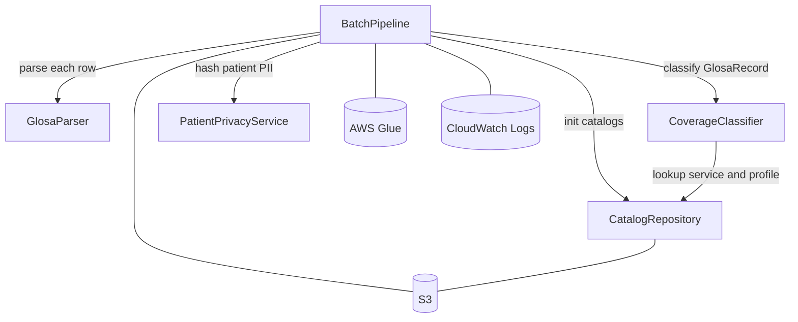

# Component Catalogue — 261109-aws-medical-batch

```yaml
components:

  - name: GlosaParser
    summary: Parses raw glosa text strings into structured medical order records
    behaviour: >
      Applies regex patterns to extract PerfilCobertura, ServicioSolicitado, DNO,
      SeguroSocial, Edad, Fecha, EntidadEmisora, MedioEmisor and ValorProcedimiento
      from the free-text glosa field. Raises ParseError (ERROR_PARSEO) when any
      required field (PerfilCobertura, ServicioSolicitado, DNO, SeguroSocial) is
      absent or the glosa format is unrecognisable. Failure to extract Medicacion
      alone does NOT raise ParseError — the record proceeds to classification.
    responsibilities:
      - Parse raw glosa text into GlosaRecord
      - Validate presence of the four required classification fields
      - Raise ParseError with ERROR_PARSEO marker for unrecoverable parse failures
    depends_on: []
    dependents:
      - component: BatchPipeline
        interaction: provides GlosaRecord for each input row
    external_dependencies: []
    entities:
      - name: GlosaRecord
        identifier: id_solicitud
        attributes:
          - id_solicitud
          - perfil_cobertura
          - servicio_solicitado
          - dno
          - seguro_social
          - edad
          - fecha
          - entidad_emisora
          - medio_emisor
          - valor_procedimiento
          - medicacion
        references: []

  - name: CatalogRepository
    summary: Loads and exposes in-memory lookup access to the two CSV classification catalogs
    behaviour: >
      Reads COIL_catalogo_servicios_cubiertos.csv and
      COIL_catalogo_perfiles_cobertura.csv from a configurable path (S3 or local).
      Builds an immutable frozenset of covered service names including ONLY rows
      where cubre_sistema_publico = SI; rows with any other value are excluded.
      Builds an immutable dict mapping perfil_cobertura to porcentaje_cobertura.
      Catalogs are treated as read-only after initialisation for the entire job
      run; no reload occurs mid-batch. Provides two pure query methods:
      is_service_covered(name) and get_profile_percentage(profile).
    responsibilities:
      - Load ServiceCatalog and ProfileCatalog from CSV at job startup
      - Expose is_service_covered and get_profile_percentage query methods
      - Hold catalogs as immutable in-memory structures for the full run
    depends_on: []
    dependents:
      - component: CoverageClassifier
        interaction: provides coverage and profile lookup for classification
      - component: BatchPipeline
        interaction: initialises catalogs at job startup
    external_dependencies:
      - name: S3
        kind: object-store
        purpose: source location of COIL_catalogo_servicios_cubiertos.csv and COIL_catalogo_perfiles_cobertura.csv
    entities:
      - name: ServiceCatalog
        identifier: nombre_servicio
        attributes:
          - nombre_servicio
          - cubre_sistema_publico
        references: []
      - name: ProfileCatalog
        identifier: perfil_cobertura
        attributes:
          - perfil_cobertura
          - porcentaje_cobertura
        references: []

  - name: CoverageClassifier
    summary: Determines coverage status and percentage for a parsed medical order
    behaviour: >
      Looks up GlosaRecord.servicio_solicitado in ServiceCatalog via CatalogRepository.
      If not found: returns ClassificationResult(cubre=NO, porcentaje=0, regla=RG-00,
      valor_cubierto=0). If found: looks up GlosaRecord.perfil_cobertura in
      ProfileCatalog. If profile not found: raises ProfileError (ERROR_PERFIL).
      If found: returns ClassificationResult(cubre=SI, porcentaje=P, regla=RG-01,
      valor_cubierto=valor_procedimiento*P/100). The classification is deterministic
      and stateless; two calls with the same inputs always produce the same result.
    responsibilities:
      - Apply coverage classification rules against the two catalogs
      - Calculate valor_cubierto for covered records
      - Raise ProfileError with ERROR_PERFIL for unrecognised profiles
    depends_on:
      - component: CatalogRepository
        interaction: query service coverage and profile percentage
        style: sync
    dependents:
      - component: BatchPipeline
        interaction: provides ClassificationResult for each GlosaRecord
    external_dependencies: []
    entities:
      - name: ClassificationResult
        identifier: id_solicitud
        attributes:
          - id_solicitud
          - cubre
          - porcentaje_cobertura
          - regla_aplicada
          - valor_cubierto
        references:
          - entity: GlosaRecord
            owned_by: GlosaParser
            relationship: each ClassificationResult is derived from exactly one GlosaRecord

  - name: PatientPrivacyService
    summary: Generates an irreversible patient identifier from PII fields
    behaviour: >
      Normalises both inputs before hashing: strips leading/trailing whitespace and
      converts to uppercase (e.g. " 12345678a " → "12345678A"). Then computes
      SHA-256(normalised_DNO + "|" + normalised_SeguroSocial) as a 64-character
      lowercase hex string. The "|" separator prevents hash collisions between
      field-boundary variants (e.g. dno="AB" + ss="CD" vs dno="A" + ss="BCD"). The two input PII attributes (dno, seguro_social) are consumed
      here and never forwarded to any output record. Deterministic: the same
      DNO+SeguroSocial pair always produces the same hash across job runs regardless
      of leading/trailing spaces or letter case. Pure function; holds no state.
    responsibilities:
      - Hash DNO+SeguroSocial into a 64-char hex string (paciente_hash)
      - Ensure PII fields are not propagated beyond this component
    depends_on: []
    dependents:
      - component: BatchPipeline
        interaction: provides paciente_hash for each GlosaRecord
    external_dependencies: []
    entities: []

  - name: BatchPipeline
    summary: PySpark job that orchestrates the full medical order classification workflow
    behaviour: >
      Entry point for the AWS Glue job. Reads the input CSV from S3 as a Spark
      DataFrame. Generates a UUID run_id at job start. For each row: invokes
      GlosaParser — on ParseError routes to quarantine (ERROR_PARSEO); on success
      invokes PatientPrivacyService for paciente_hash and CoverageClassifier —
      on ProfileError routes to quarantine (ERROR_PERFIL); on success builds
      ProcessedRecord. Writes the ProcessedRecord DataFrame to S3 as Parquet
      partitioned by fecha. Writes QuarantineRecord DataFrame to S3 quarantine/.
      Logs records_input, records_output, records_quarantined_parseo,
      records_quarantined_perfil, duration_seconds and run_id to stdout for
      CloudWatch capture.
    responsibilities:
      - Read input CSV from S3 and drive the PySpark transformation DAG
      - Generate run_id; set timestamp_proceso for each record
      - Route records to output Parquet or quarantine based on component outcomes
      - Write output and quarantine partitions to S3
      - Emit CloudWatch-readable metrics log at job completion
    depends_on:
      - component: GlosaParser
        interaction: parse each row into GlosaRecord or raise ParseError
        style: sync
      - component: PatientPrivacyService
        interaction: compute paciente_hash from GlosaRecord PII fields
        style: sync
      - component: CoverageClassifier
        interaction: classify each GlosaRecord into ClassificationResult
        style: sync
      - component: CatalogRepository
        interaction: initialise catalogs at job start and pass instance to CoverageClassifier
        style: sync
    dependents: []
    external_dependencies:
      - name: S3
        kind: object-store
        purpose: source of input CSV; destination for output Parquet and quarantine files; source of catalog CSVs
      - name: AWS Glue
        kind: other
        purpose: managed PySpark execution runtime; provides job parameters and CloudWatch log routing
      - name: CloudWatch Logs
        kind: other
        purpose: captures stdout log lines emitted by the job for observability and evidence
    entities:
      - name: ProcessedRecord
        identifier: id_solicitud
        attributes:
          - id_solicitud
          - paciente_hash
          - cubre
          - porcentaje_cobertura
          - perfil_cobertura
          - servicio_solicitado
          - entidad_emisora
          - medio_emisor
          - valor_procedimiento
          - valor_cubierto
          - regla_aplicada
          - run_id
          - fecha
          - timestamp_proceso
        references:
          - entity: GlosaRecord
            owned_by: GlosaParser
            relationship: each ProcessedRecord is derived from one GlosaRecord
          - entity: ClassificationResult
            owned_by: CoverageClassifier
            relationship: each ProcessedRecord incorporates one ClassificationResult
      - name: QuarantineRecord
        identifier: id_solicitud
        attributes:
          - id_solicitud
          - cubre
          - run_id
          - timestamp_proceso
        references:
          - entity: GlosaRecord
            owned_by: GlosaParser
            relationship: each QuarantineRecord originates from one GlosaRecord (or raw row on parse failure)
```

---

## Component Diagram



---

## Component Summary

| Component | Purpose | Depends On | Dependents | Entities Owned |
|---|---|---|---|---|
| GlosaParser | Parse raw glosa text into structured records | — | BatchPipeline | GlosaRecord |
| CatalogRepository | Load and expose coverage catalog lookups | — | CoverageClassifier, BatchPipeline | ServiceCatalog, ProfileCatalog |
| CoverageClassifier | Apply classification rules; return coverage result | CatalogRepository | BatchPipeline | ClassificationResult |
| PatientPrivacyService | Hash patient PII into irreversible identifier | — | BatchPipeline | — |
| BatchPipeline | Orchestrate PySpark job: read → classify → write | GlosaParser, CoverageClassifier, PatientPrivacyService, CatalogRepository | — | ProcessedRecord, QuarantineRecord |

---

## Entity Ownership

| Entity | Owning Component | Identifier | Key Attributes | References |
|---|---|---|---|---|
| GlosaRecord | GlosaParser | id_solicitud | perfil_cobertura, servicio_solicitado, dno, seguro_social, fecha, valor_procedimiento | — |
| ServiceCatalog | CatalogRepository | nombre_servicio | nombre_servicio, cubre_sistema_publico | — |
| ProfileCatalog | CatalogRepository | perfil_cobertura | perfil_cobertura, porcentaje_cobertura | — |
| ClassificationResult | CoverageClassifier | id_solicitud | cubre, porcentaje_cobertura, regla_aplicada, valor_cubierto | GlosaRecord (GlosaParser) |
| ProcessedRecord | BatchPipeline | id_solicitud | 14 output fields (FR7 schema) | GlosaRecord, ClassificationResult |
| QuarantineRecord | BatchPipeline | id_solicitud | id_solicitud, cubre (error code), run_id, timestamp_proceso | GlosaRecord |

---

## External Dependencies

| Component | Dependency | Kind | Purpose |
|---|---|---|---|
| BatchPipeline | S3 | object-store | Input CSV, output Parquet, quarantine files |
| BatchPipeline | AWS Glue | other | Managed PySpark runtime; job parameters |
| BatchPipeline | CloudWatch Logs | other | Execution metrics and evidence |
| CatalogRepository | S3 | object-store | CSV catalog source files |

---

## Rationale

| Component | Why a separate building block |
|---|---|
| GlosaParser | Distinct concern (text parsing vs. business classification). Different change rate — if the glosa format changes, only GlosaParser changes. Independently testable with simple string inputs. |
| CatalogRepository | Distinct data ownership (the two CSV catalogs). Separating catalog I/O from classification logic allows CoverageClassifier to be tested with mock catalogs and CatalogRepository to be tested with mock CSVs independently. |
| CoverageClassifier | Owns the core business rules (coverage logic). Single concern: given a service and a profile, what is the coverage? Separating it from BatchPipeline makes the classification rule independently testable without a Spark session. |
| PatientPrivacyService | Privacy-critical concern that must be isolated: it is the single point where PII is consumed and must not propagate. Isolating it makes it trivially verifiable that no PII escapes it. |
| BatchPipeline | Owns the PySpark execution context, run_id, timestamp, and S3 I/O. Separation from the business components allows the pipeline driver to change (e.g., switch from Glue to EMR) without touching classification logic. |
