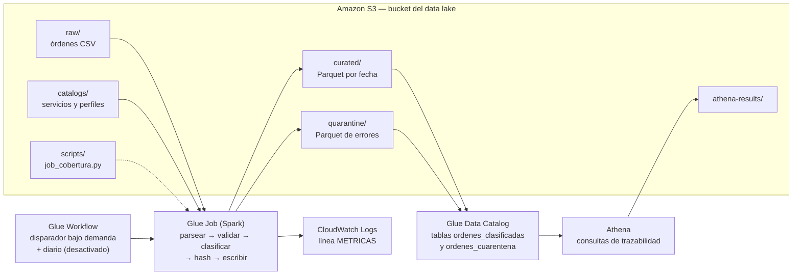

# Arquitectura — Clasificación batch de órdenes médicas en AWS

> Requisitos en [requisitos.md](requisitos.md). Parámetros y esquemas en [contratos.md](contratos.md).

## 1. Vista general

Texto equivalente: el Workflow de Glue lanza el Job. El Job lee las órdenes de `raw/` y los catálogos de `catalogs/`, procesa en paralelo en los workers de Spark y escribe las decisiones en `curated/` (Parquet particionado por fecha) y los errores en `quarantine/`. Al terminar deja sus métricas en CloudWatch. Las dos salidas están registradas como tablas en el Glue Data Catalog y se consultan con Athena.

Toda la infraestructura (bucket, job, workflow, disparadores, base de datos y tablas del catálogo, workgroup de Athena) la crea **una sola plantilla de CloudFormation**.

## 2. Flujo del enunciado → componentes

| Paso del enunciado | Dónde ocurre |
|---|---|
| 1. Recepción | Archivo CSV en `raw/` (S3) |
| 2. Extracción | `GlosaParser` |
| 3. Clasificación | `CoverageClassifier` con `CatalogRepository` |
| 4. Cobertura | `CoverageClassifier` (porcentaje y `valor_cubierto`) |
| 5. Decisión trazable | `BatchPipeline` escribe `curated/` / `quarantine/` con `run_id`; Athena la consulta |

## 3. Componentes

Todos viven en un único archivo, `src/job_cobertura.py`, para que el despliegue sea subir un solo script. Los cuatro primeros son **Python puro** (sin Spark ni AWS) y se prueban localmente; el quinto es el punto de entrada de Glue.

| Componente | Responsabilidad | Entrada → salida |
|---|---|---|
| **GlosaParser** | Extraer `DNO`, `SeguroSocial`, `PerfilCobertura`, `ServicioSolicitado` de la glosa con expresiones regulares tolerantes al orden y a espacios. Si falta alguno, o `valor_procedimiento` no es numérico → `ERROR_PARSEO`. | fila CSV → campos parseados o error |
| **CatalogRepository** | Cargar los dos catálogos una vez al inicio: conjunto de servicios con `cubre_sistema_publico = SI` (columna `servicio`) y diccionario perfil → porcentaje. Inmutable durante la ejecución. | CSV → `Catalogos` |
| **CoverageClassifier** | Aplicar la regla FR4: perfil desconocido → `ERROR_PERFIL`; servicio cubierto → `SI`/`RG-01`/porcentaje del perfil; si no → `NO`/`RG-00`/0. Calcular `valor_cubierto`. | campos parseados + catálogos → decisión |
| **PatientPrivacyService** | `SHA-256(upper(trim(DNO)) + "\|" + upper(trim(SeguroSocial)))`. Único punto donde se tocan datos personales; nada de PII sale de aquí. | DNO, seguro social → `paciente_hash` |
| **BatchPipeline** | Punto de entrada de Glue: leer parámetros, leer CSV, replicar si `factor_replicacion > 1`, distribuir los catálogos a los workers (*broadcast*), aplicar los cuatro componentes por partición (`mapPartitions`), separar resultados y errores, escribir Parquet, emitir la línea `METRICAS`. | S3 → S3 + CloudWatch |

## 4. Decisiones de arquitectura

### ADR-001 — AWS Glue (Spark serverless) como motor de procesamiento

- **Contexto:** 12 M de órdenes en < 24 h, laboratorio con sesiones de 4 h y créditos limitados; el curso evalúa procesamiento distribuido.
- **Decisión:** AWS Glue 5.0 (Spark 3.5, Python 3.11), workers G.1X, número de workers como parámetro.
- **Consecuencias:** sin clúster que administrar ni apagar; se paga por segundo de ejecución (DPU-hora); integración directa con S3, Data Catalog y CloudWatch. En contra: el costo por DPU-hora es mayor que EMR en cargas continuas, y hay un tiempo de arranque fijo por ejecución.
- **Alternativas descartadas:**
  - *Amazon EMR:* misma lógica Spark, pero hay que crear, dimensionar y apagar el clúster; más riesgo operativo en sesiones de 4 h. Sería el camino si la carga fuera continua y mucho mayor.
  - *AWS Lambda:* límite de 15 min por invocación; habría que trocear el archivo y coordinar miles de invocaciones a mano, que es reinventar un motor distribuido.
  - *Athena SQL (CTAS):* para este volumen sería probablemente lo más barato y simple: una consulta con `regexp_extract`, `sha256` y un `JOIN` con los catálogos. Se descarta como motor porque la lógica queda en SQL difícil de probar unitariamente, el manejo de cuarentena es más rígido y no demuestra procesamiento distribuido programable, que es el objetivo del curso. **Sí se usa Athena para consultar los resultados** (ADR-002).

### ADR-002 — S3 como data lake por zonas + Data Catalog + Athena para consultar

- **Contexto:** la Opción 1 exige "estrategia robusta de almacenamiento"; la trazabilidad debe poder verificarse orden por orden.
- **Decisión:** un bucket con zonas por prefijo (`raw/`, `catalogs/`, `scripts/`, `curated/`, `quarantine/`, `athena-results/`). Salidas en Parquet (columnar, comprimido con Snappy), `curated/` particionado por `fecha`. Tablas definidas en la plantilla con *partition projection*, sin necesidad de un crawler. Consultas con Athena.
- **Consecuencias:** un solo destino barato y durable; Parquet reduce lo que Athena escanea; consultar una decisión es una línea de SQL. Las tablas existen desde que se crea el stack.
- **Alternativas descartadas:** *DynamoDB* (escritura registro a registro de 12 M es más lenta y cara, y el uso es analítico, no transaccional); *CSV como salida* (más pesado y más caro de consultar); *Glue Crawler* (costo y un paso más, innecesario si el esquema es fijo y conocido); *varios buckets* (más recursos que administrar sin beneficio de seguridad real en un laboratorio con un único rol).

### ADR-003 — SHA-256 con normalización como identificador irreversible del paciente

- **Decisión:** `SHA-256(upper(trim(DNO)) + "|" + upper(trim(SeguroSocial)))`. El separador evita colisiones entre límites de campo; la normalización evita que espacios o mayúsculas cambien el hash.
- **Consecuencias:** sin costo ni servicio externo; permite correlacionar órdenes del mismo paciente sin revelar quién es.
- **Riesgo conocido:** sin una clave secreta (*salt*), un atacante que conozca el formato de los identificadores podría intentar fuerza bruta. Para producción se usaría HMAC con una clave en AWS Secrets Manager; para el prototipo se documenta como mejora.
- **Alternativas descartadas:** *cifrado simétrico* (es reversible); *tokenización con tabla de mapeo* (la tabla contendría PII); *no guardar identificador* (se pierde la correlación).

### ADR-004 — Clasificación determinista por catálogo, no aprendizaje automático

- **Decisión:** búsqueda exacta en los dos catálogos.
- **Consecuencias:** 100 % trazable (cada decisión indica su regla), reproducible y totalmente probable. El enunciado entrega los catálogos como fuente de verdad, así que el espacio de decisión es cerrado.
- **Alternativa descartada:** *ML/NLP*, sobredimensionado y no explicable para un espacio cerrado de 20 servicios × 3 perfiles.

### ADR-005 — CloudFormation como infraestructura como código

- **Decisión:** plantilla YAML con parámetro obligatorio `LabRoleArn`; sin recursos `AWS::IAM::Role`.
- **Consecuencias:** reproducible y legible por el comité; se puede crear desde la consola sin instalar nada.
- **Alternativas descartadas:** *CDK* (agrega Node.js y genera CloudFormation de todos modos); *Terraform* (requiere estado externo y no está en el laboratorio).

### ADR-006 — Lógica en Python puro aplicada con `mapPartitions`

- **Contexto:** se quiere que el código probado sea exactamente el código que corre en Glue, sin instalar Spark localmente.
- **Decisión:** los cuatro componentes de negocio son funciones de Python puro; Spark las aplica partición por partición, con los catálogos distribuidos por *broadcast*.
- **Consecuencias:** las pruebas cubren la misma lógica que procesa los 12 M; no hay dos implementaciones. En contra: Python por fila es más lento que las funciones nativas de Spark (`regexp_extract`, `sha2`, `join`). Para 12 M de órdenes se espera que alcance holgadamente; **se confirma con la ejecución real de 12 M** (FR8). Si no alcanzara, la alternativa es reescribir el job con funciones nativas de Spark.

### ADR-007 — Perfil desconocido va a cuarentena

- **Decisión:** un perfil fuera de catálogo es un error de datos (`ERROR_PERFIL`) y se valida antes de mirar el servicio; no se aplica un porcentaje por defecto.
- **Consecuencias:** ningún registro recibe una decisión equivocada en silencio; un catálogo incompleto se detecta en la cuarentena.
- **Alternativa descartada:** *asumir 0 %*, que ocultaría el error y negaría cobertura a alguien con un perfil legítimo no registrado.

### ADR-008 — Orquestación con Glue Workflow

- **Contexto:** la Opción 1 exige orquestación; en operación real el lote llega cada día.
- **Decisión:** un Glue Workflow con un disparador bajo demanda (demo) y uno programado diario (creado pero desactivado, para no consumir créditos).
- **Consecuencias:** historial de ejecuciones por workflow; extensible a más pasos (por ejemplo, validar el archivo antes de procesarlo).
- **Alternativas descartadas:** *Step Functions* (más flexible pero más piezas para un flujo de un solo paso); *EventBridge + Lambda* (más código propio); *ejecutar el job a mano* (no es orquestación).

## 5. Escalabilidad

- Spark reparte las filas entre los workers; el procesamiento por fila no depende de las demás filas (salvo la lectura de los catálogos, que se distribuyen a todos). El costo crece de forma aproximadamente lineal con el volumen, y el tiempo baja al agregar workers.
- 12 M en 24 h equivale a unas 139 órdenes por segundo de rendimiento mínimo requerido.
- **Evidencia a recoger:** `duration_seconds` y workers usados en la ejecución de 1,2 M y en la de 12 M. Con eso se calculan órdenes por segundo por worker y cuántos workers harían falta para otros volúmenes.

| Ejecución | Registros | Workers (G.1X) | `duration_seconds` | Órdenes/s |
|---|---|---|---|---|
| 1,2 M | 1 200 000 | _pendiente_ | _pendiente_ | _pendiente_ |
| 12 M | 12 000 000 | _pendiente_ | _pendiente_ | _pendiente_ |

## 6. Costo

Las cifras se completan con la AWS Pricing Calculator (región del laboratorio) y con lo observado en la consola. **No se inventan.**

| Dimensión | Cantidad por ejecución de 12 M | Precio unitario (fuente) | Costo |
|---|---|---|---|
| Glue: DPU-hora (workers × horas) | _pendiente_ | _pendiente_ | _pendiente_ |
| S3: almacenamiento (GB-mes de raw + curated) | _pendiente_ | _pendiente_ | _pendiente_ |
| S3: solicitudes PUT/GET | _pendiente_ | _pendiente_ | _pendiente_ |
| Athena: TB escaneados por consultas | _pendiente_ | _pendiente_ | _pendiente_ |
| CloudWatch Logs: GB ingeridos | _pendiente_ | _pendiente_ | _pendiente_ |
| **Total por ejecución / por mes (30 ejecuciones)** | | | _pendiente_ |

## 7. Seguridad y privacidad

- Sin datos personales en salidas, cuarentena ni logs (FR6, NFR2).
- Bucket con cifrado SSE-S3 y bloqueo de acceso público.
- Sin credenciales en el código; el job usa el `LabRole`.
- Limitación del laboratorio: un único rol con permisos amplios. En producción se separarían roles por servicio con mínimo privilegio.

## 8. Ajustes respecto al diseño inicial

El primer diseño se hizo con el marco AI-DLC. Al consolidarlo se corrigieron estos puntos:

| # | Antes | Ahora | Motivo |
|---|---|---|---|
| 1 | Glue 4.0 con Python 3.11 | Glue 5.0 (Python 3.11, Spark 3.5) | Glue 4.0 usa Python 3.10; la combinación anterior no existe. |
| 2 | Columna `nombre_servicio` del catálogo | Columna `servicio` | Es el nombre real en el CSV. |
| 3 | Subir el script antes de crear el stack | Crear el stack → subir archivos → ejecutar | El bucket lo crea el propio stack. |
| 4 | Particionar por `fecha_solicitud` (fecha y hora) | Particionar por `fecha` (solo fecha) | Por fecha y hora habría una partición casi por registro. |
| 5 | 12 M "argumentados" (tiempo de 1,2 M × 10) | Ejecución real de 12 M replicando el dataset | Extrapolar ignora el arranque fijo y el paralelismo; medir es defendible. |
| 6 | Sin orquestación | Glue Workflow con disparadores (ADR-008) | La Opción 1 la exige explícitamente. |
| 7 | Resultados solo en Parquet, sin consulta | Data Catalog + Athena (ADR-002) | Permite demostrar la trazabilidad orden por orden. |
| 8 | Perfil desconocido solo se validaba si el servicio estaba cubierto | Se valida siempre, antes del servicio (ADR-007) | Coherencia con el criterio de aceptación de FR4. |
| 9 | Pruebas con DynamoDB simulado | Eliminado | DynamoDB está fuera de alcance. |
| 10 | Hash sin separador en ADR-003 | Con separador y normalización | Unificado con FR6. |
| 11 | Athena no figuraba como alternativa | Añadida en ADR-001 | Es la alternativa más barata; el comité puede preguntarla. |
| 12 | Cuarentena sin forma de demostrarse | Muestra con glosas dañadas | El dataset real no tiene errores. |
